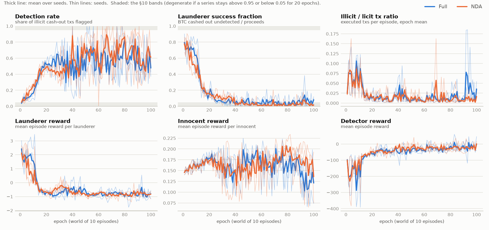
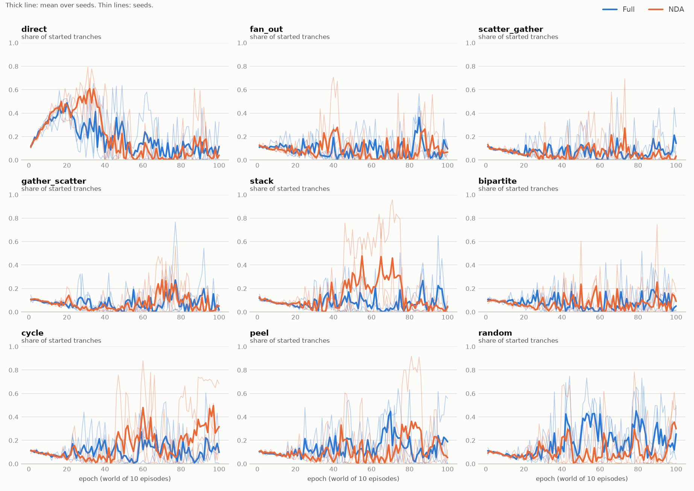
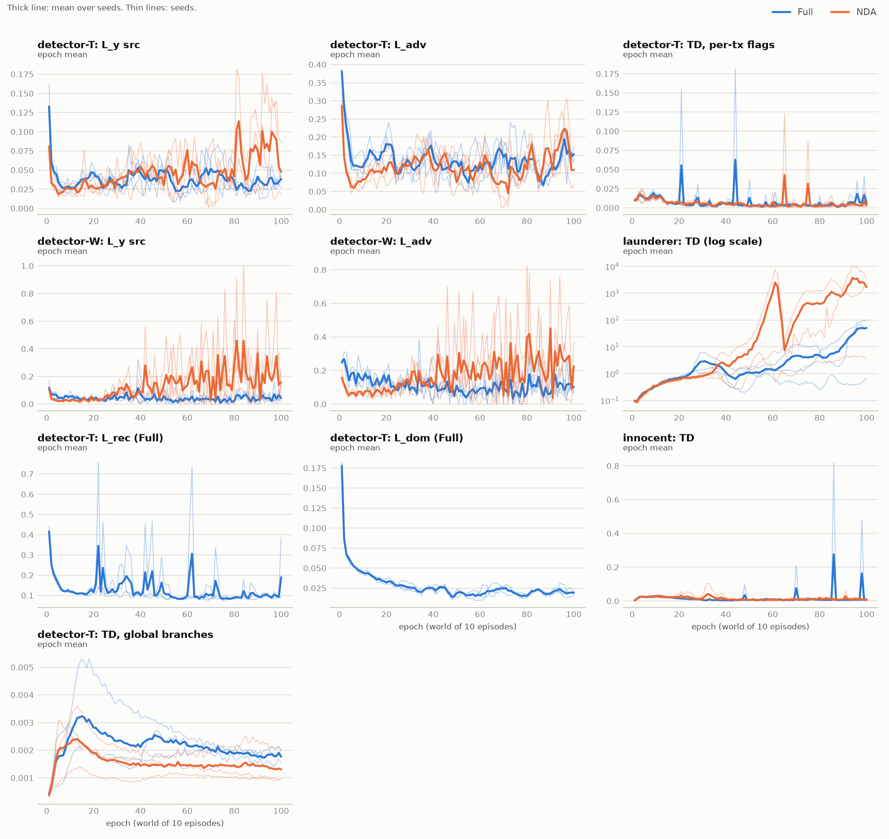

# M5: MARL pretraining (Full and NDA)

SPEC §10, §15 M5. Launderers, innocents and the inspector (detector-T) co-evolve in the SISTS-lite multiverse; detector-W trains on each finished world's export. Full adds in-loop `L_aux` on unlabelled real fitting-split views; NDA has no `L_aux` and reads no real batch. No real label is read in either arm.

Report code: `be08b8cfad7175b08e32e1ae792fc3355ba46ff2-dirty`. Generated by `uv run python -m hns.marl.report`. Run code and device are in each run's `config.yaml`.

## Acceptance (§15)

Health curves present; no NaNs (a run stops on any non-finite epoch loss); 1000 episodes complete; non-degenerate (§10: over the last 20 epochs, neither the detection rate nor the launderer success fraction stays above 0.95 or below 0.05).

| Arm | Seed | Episodes | Finite losses | Detection rate, last 20 epochs (min–max) | Success fraction, last 20 epochs (min–max) | Epochs of the last 20 with success < 0.05 | Degenerate (§10 rule) | Wall time | Pass |
|---|---|---|---|---|---|---|---|---|---|
| Full | 0 | 1000 / 1000 | yes | 0.28–0.90 | 0.00–0.18 | 12 | no | 3.7 h | yes |
| Full | 1 | 1000 / 1000 | yes | 0.25–0.80 | 0.00–0.38 | 9 | no | 3.8 h | yes |
| Full | 2 | 1000 / 1000 | yes | 0.32–0.88 | 0.00–0.11 | 15 | no | 3.8 h | yes |
| NDA | 0 | 1000 / 1000 | yes | 0.22–1.00 | 0.00–0.06 | 19 | no | 3.7 h | yes |
| NDA | 1 | 1000 / 1000 | yes | 0.27–0.95 | 0.00–0.18 | 9 | no | 3.5 h | yes |
| NDA | 2 | 1000 / 1000 | yes | 0.27–0.96 | 0.00–0.10 | 18 | no | 3.5 h | yes |

The §10 rule only calls a run degenerate if a series stays in a band for all 20 epochs. Read the pass together with the findings below.

## Findings

All six runs completed and meet the §15 checks by the letter. Two things in the results mean they should not be read as a working co-evolution yet.

**1. The inspector dominates from about epoch 25–40 on.** In the first 10 epochs (ε ≈ 1) launderers cash out 56–77 % of their proceeds, depending on the run. As ε decays the detection rate rises (last 20 epochs: 0.22–1.00 across epochs, arm means 0.57 and 0.62) and the success fraction falls below 0.05 for the first time at epochs 25–38. Over epochs 31–100 its mean is 0.027–0.053 per run. In the last 20 epochs it is below 0.05 in 9–19 epochs per run; NDA seed 0 is one epoch away from the §10 degenerate verdict. Launderers' mean episode reward is −0.7 to −1.0 there, although waiting would cost only −0.05. Tranches per launderer and episode fall from 2.9–3.7 (first 10 epochs) to 0.7–1.8 (last 20).

**2. The launderers' Q-learning is unstable.** The launderer TD loss passes 5 in five of the six runs (first at epochs 29–65) and peaks between 6.1 and 10,562; only Full seed 0 stays below 2. At the end of training the launderer network values an idle state at `Q(wait)` = 6.5, 186, 60 (Full seeds 0–2) and 143, 357, 33 (NDA seeds 0–2), while no return above a few units is attainable and realized rewards are negative. These values come from `scripts/m5_qprobe.py`: final checkpoints, two episodes of one fresh world at ε = 0.05, no training.

The likely cause is the §10 target as written. This is a diagnosis from the checkpoints, not confirmed by a run with the target changed. In an idle state all six branches are in `B(s')`, so the target averages each branch's maximum. When the launderer waits, only the `initiate` branch is realized and trained. The other five branches (amount, recipient, strategy, mules, change) are trained only on launches, yet carry 5/6 of the target. With the dueling form, pushing a punished option down raises the untried options of its branch, so the target can sit above `Q(wait)`, and that gap is bootstrapped every sub-step. In the probe the target exceeds `Q(wait)` by +1.1 to +3.5 in five of the six runs (−0.8 in NDA seed 1); a gap of 2 at γ = 0.99 gives values near 200, which is the observed scale. The innocents, whose usual choice is to act now so that all their branches are trained, show no such growth: their TD loss stays below 0.11 in five runs and peaks at 0.82 in one epoch of Full seed 1.

With values this inflated the launderer policy is not a response to the inspector. In four runs the greedy choice in an idle state is to wait (the probe finds `go` greedy in 1–20 % of idle states), so most launches there come from ε-exploration. In Full seed 0 and NDA seed 2 the launderers still launch by choice (`go` greedy in 92–97 %).

**What this means for the next milestones.**
- The detectors trained without a non-finite loss, and `L_y^src` on labelled simulator nodes ends at 0.03–0.11 (T) and 0.04–0.34 (W) per run. But after about epoch 30 the illicit behaviour they saw came from a launderer policy driven by inflated values or by exploration, at a low volume: the illicit/licit ratio is 0.006–0.050 per run in the last 20 epochs, against 0.052–0.073 in the first 10.
- So a Full − NMAI difference in M6/M7 could not be attributed to co-evolution, and the launderer-side curves of Full and NDA should not be compared with each other.
- Two SPEC decisions are open: the launderer target (finding 2), and what to do if the inspector still dominates once it is fixed (§16: "the launderers are too weak"). §9.3's per-tranche reward (up to +1 per tranche whatever its size) also deserves a look: in two short single-seed pilot runs with a fast ε schedule, launderers moved to many small `direct` tranches.

**Other observations.**
- The inspector's budget is 0.05–0.07 in the last 20 epochs, with flag precision 0.06–0.23 per run. In one pilot run it sat near the 1 % floor; the full runs do not show that.
- Strategy shares: `direct` starts at 10–13 % of tranches (uniform is 11 %), its seed-mean share peaks at 49 % (Full, epoch 20) and 61 % (NDA, epoch 32), and it is back at 1–19 % per seed in the last 20 epochs, when shares vary widely between seeds and epochs. So launderers did move toward `direct` while they were still learning, before finding 2 set in.
- NDA's detector-W `L_y^src` rises after about epoch 40 while Full's does not. The loss is weighted by `pos_weight = sqrt(n_neg / n_pos)`, which grows as labelled illicit wallets get rarer, and NDA's late worlds hold fewer illicit txs. I did not separate that effect from a worse fit, so the gap is not evidence about detector quality.
- No transfer result exists yet: nothing here says whether Full or NDA pretraining helps on Elliptic++.

## Health curves (§10; they replace Figs. 4–5)

Mean over the last 20 epochs, then mean ± sd over seeds:

| Arm | Detection rate | Success fraction | Frozen fraction | Illicit / licit ratio | Launderer reward | Innocent reward | Detector reward | Budget `b` | Depth-2 share | Flag precision |
|---|---|---|---|---|---|---|---|---|---|---|
| Full | 0.567 ± 0.054 | 0.060 ± 0.021 | 0.436 ± 0.039 | 0.025 ± 0.018 | -0.820 ± 0.108 | 0.144 ± 0.016 | -18.190 ± 7.071 | 0.065 ± 0.007 | 0.562 ± 0.057 | 0.129 ± 0.071 |
| NDA | 0.621 ± 0.086 | 0.030 ± 0.019 | 0.336 ± 0.086 | 0.010 ± 0.004 | -0.815 ± 0.115 | 0.173 ± 0.022 | -21.951 ± 7.797 | 0.062 ± 0.007 | 0.660 ± 0.059 | 0.075 ± 0.015 |

First 10 epochs (epsilon ≈ 1: near-random play), for comparison:

| Arm | Detection rate | Success fraction | Illicit / licit ratio | Launderer reward | Detector reward |
|---|---|---|---|---|---|
| Full | 0.109 ± 0.024 | 0.712 ± 0.060 | 0.064 ± 0.007 | 1.826 ± 0.398 | -172.080 ± 20.593 |
| NDA | 0.151 ± 0.016 | 0.623 ± 0.048 | 0.058 ± 0.004 | 1.230 ± 0.246 | -154.761 ± 16.394 |

## Strategy usage (share of started tranches)

Mean over the last 20 epochs, then mean ± sd over seeds:

| Arm | `direct` | `fan_out` | `scatter_gather` | `gather_scatter` | `stack` | `bipartite` | `cycle` | `peel` | `random` |
|---|---|---|---|---|---|---|---|---|---|
| Full | 0.094 ± 0.027 | 0.114 ± 0.047 | 0.081 ± 0.021 | 0.078 ± 0.043 | 0.102 ± 0.017 | 0.101 ± 0.039 | 0.106 ± 0.022 | 0.118 ± 0.051 | 0.206 ± 0.089 |
| NDA | 0.081 ± 0.081 | 0.101 ± 0.047 | 0.027 ± 0.016 | 0.056 ± 0.021 | 0.049 ± 0.043 | 0.083 ± 0.064 | 0.299 ± 0.145 | 0.184 ± 0.120 | 0.121 ± 0.082 |

## Losses

Mean over the last 20 epochs, then mean ± sd over seeds:

| Arm | `t_y_src` | `t_adv` | `t_td_flag` | `w_y_src` | `w_adv` | `td_launderer` | `t_rec` | `t_dom` | `td_innocent` | `t_td_global` |
|---|---|---|---|---|---|---|---|---|---|---|
| Full | 0.032 ± 0.005 | 0.126 ± 0.009 | 0.006 ± 0.002 | 0.047 ± 0.003 | 0.109 ± 0.018 | 21.337 ± 16.697 | 0.103 ± 0.012 | 0.020 ± 0.002 | 0.028 ± 0.032 | 0.002 ± 0.000 |
| NDA | 0.076 ± 0.026 | 0.151 ± 0.010 | 0.004 ± 0.001 | 0.227 ± 0.090 | 0.248 ± 0.065 | 1657.706 ± 1396.632 | — | — | 0.011 ± 0.004 | 0.001 ± 0.001 |

## Decisions this milestone added (ours)

The SPEC leaves these open; each is a choice made while implementing §10. None changes the §9.3 reward table or the simulator's dynamics.

- **Live graph.** The agents and the inspector observe a graph kept equal to the committed ledger (`hns.sim.live`). A sub-step's tentative txs are added for scoring, as if committed, and removed again before the commit, so a reverted tx leaves no trace. Its tx features and causal wallet counts are tested equal to the export's definitions.
- **Agent view.** One controller node per agent, linked to at most 10 of its addresses (launderer: source, tranche holders, newest mules; innocent: by balance), then up to 5 txs per address and link type. The controller carries the agent's private state; the agent's own addresses also carry balance, spendable-output count and two role flags. The launderer's `recipient` pointer scores the 16 candidate services from the hot wallet's causal counts and the launderer's deposit history there.
- **Global readout.** Eight observable values: time in the episode and the world; the inspector's budget; the previous sub-step's candidate count, flag share, flag precision and analysis depth; and the number of txs committed so far in the episode. At an episode's first sub-step that last value still holds the previous episode's total.
- **Next state.** An agent's next state is its next decision point. A launderer without funds and an innocent without a demand have no state, and the chain skips those sub-steps without extra discounting.
- **Exploring `select_tx`.** The env flags the top `b` share of scores, so a candidate's score is the rank of `Q_flag − Q_skip`, or a uniform draw with probability ε. Other branches: ε-greedy independently per branch.
- **Analysis depth 1** samples no hop-2 neighbours.
- **`L_y^src` source.** 128 labelled committed simulator txs per update, drawn from the current world's ledger and the last 2 finished worlds, each in its T view (committed graph restricted to `ts ≤ t`, causal counts as of `t`). `pos_weight = sqrt(n_neg / n_pos)` over that pool. The per-tx TD batch is a separate 128 replayed flag transitions (decision-time views); the three batches share one forward pass.
- **Global branches' reward unit.** `analysis_depth` and `update_strategy` are learned in units of 100 reward (`r`, `Q` and `τ` all divided by `1 / (1 − γ)`). The objective and the behaviour policy are unchanged; unscaled, the values are in the hundreds and the TD loss kept growing in a pilot run. Their warm-up is one batch (128 transitions), not 1,000, because there is one such transition per sub-step.
- **Gradient clipping.** detector-T and the global-branch network share no parameter and are clipped separately, each at 1.0.
- **detector-W's mask** is drawn once per world (a W view spans the world's episodes); detector-T's is per episode, as in §8.4.
- **Heads.** Domain head: one linear layer 64→1. Decoder: 448→256→d. KL terms are summed over latent dimensions and averaged over the batch.
- **Acting** uses eval mode (no dropout); updates use dropout 0.5.
- **Forward route.** The +0.1 of an innocent's scripted hop 2 is credited to the decision that chose the route.
- **Checkpoints** every 2 worlds (20 episodes, within §10's 25), at world boundaries: models, optimizers, buffers, source pool, RNG states. A resumed run replays the interrupted world; on CPU this reproduces the uninterrupted run's records (tested).
- **Health definitions.** Detection rate: flagged share of illicit cash-out candidates. Illicit/licit ratio: over committed txs, frozen ones included. Success fraction: BTC cashed out undetected / BTC of proceeds received in the world.

## Compute

- All six runs ran side by side on one JarvisLabs A30 (IN2, on-demand, $0.41/h), fp32: 3.5–3.8 h per run, 4.1 h wall for all six. The account was charged $2.04 in total (about 4.8 A30-hours with setup, tests and both benchmarks, plus a short resume to copy the rest off), against the §15 estimate of 15 h for M5.
- The instance was destroyed on 2026-11-10 after everything but the two benchmarks' model checkpoints was copied off and checked (sha256). Kept locally under `runs/` (git-ignored): each run's metrics, config, log, `final.pt` and resume checkpoint `last.pt`; the benchmarks' metrics and logs; and `runs/marl/code_be08b8c-dirty.b1692c76e2b5.tgz`, the exact uncommitted source that produced the runs.
- bf16 autocast (§3) is implemented as an option but was not used or tested on the A30.
- 20-episode benchmark (§15), six processes on the A30: 209–260 s per world. With CUDA MPS, started inside the container: 108–125 s per world. The runs use MPS (`scripts/m5_all.sh`).
- One run alone on the local GTX 1650 Super: 105 s per world (NDA), 123–134 s (Full).

## Changes outside the new modules

- `hns.sim.env`, `hns.sim.entities`: optional live-graph hooks, health accounting (`env.acct`), `Demand.born`, `end_episode()`. No random draw or dynamic changed; the M4 tests pass unchanged.
- `hns.models.detector`: the encoder is split out as `Encoder` for the role Q-networks; DA heads and the flag head are optional. T0 checkpoints load unchanged and initialization under a seed is identical (checked against the M3 code).
- `hns.eval.rf_anchor.git_sha`: falls back to `.git_sha`, which `scripts/jl_upload.sh` writes, because the instance has no git.
- `matplotlib` added to the dependencies for the report figures.
